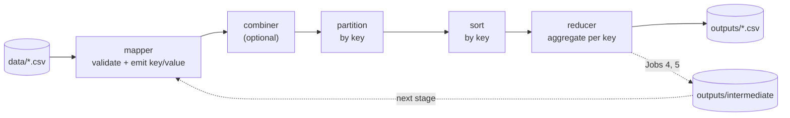
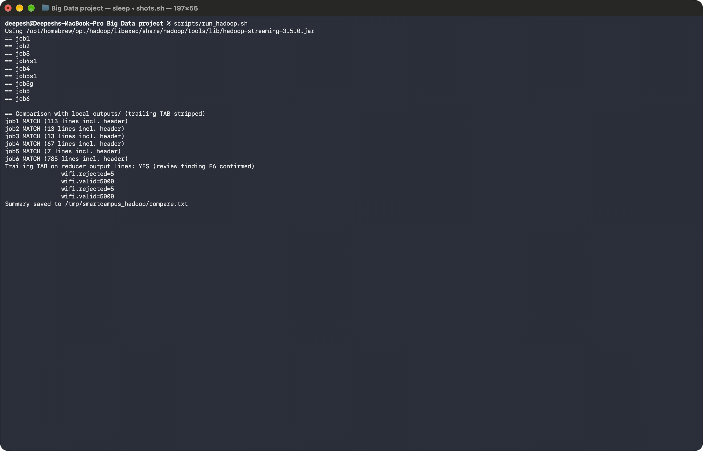

# SmartCampusAnalytics

**Campus operations insights from Wi-Fi, canteen, library and transport logs, computed with
MapReduce in Python on Hadoop Streaming.**

| | |
|---|---|
| **Jobs** | 6 required MapReduce jobs + 1 extension job (9 MapReduce stages in total) |
| **Correctness** | 38 tests pass; every output row matches an independent reference implementation |
| **Hadoop** | All 7 outputs identical on real Hadoop 3.5.0 (standalone mode) |
| **Dependencies** | None. Python 3 standard library only; Hadoop is optional |
| **Data** | Synthetic and reproducible (seed 42), with deliberately malformed rows |

Laboratory mini project for the *MapReduce Laboratory Worksheet: Smart Campus Analytics using Python
Hadoop Streaming*. Submitted by Deepesh Kakkar (roll no. 102315286).

## Contents
1. [Quick start](#quick-start)
2. [The problem](#the-problem)
3. [The seven jobs](#the-seven-jobs)
4. [Key findings](#key-findings)
5. [How it works](#how-it-works)
6. [Running the project](#running-the-project)
7. [Verification](#verification)
8. [Project structure](#project-structure)
9. [Assumptions and limitations](#assumptions-and-limitations)
10. [Documentation and submission material](#documentation-and-submission-material)

---

## Quick start
```bash
python3 scripts/run_pipeline.py                  # run all jobs; prints [PASS]/[FAIL] for every check
python3 -m unittest discover -s tests            # 38 tests
scripts/run_hadoop.sh                            # optional: rerun everything on Hadoop and compare
```
Results land in [`outputs/`](outputs/). The datasets are already in [`data/`](data/). To regenerate
them, run `python3 scripts/generate_data.py`.

**Results dashboard.** [`dashboard/`](dashboard/) is a Next.js 16 site (TypeScript, Tailwind CSS 4,
shadcn/ui, Recharts) with an overview page and one page per job. Each job page shows the job's chart,
stage design, the real mapper and reducer source, and its full sortable output. At build time it reads
`outputs/` and `src/` directly, and the export is plain static HTML with no server.
```bash
cd dashboard && npm ci && npm run dev        # http://localhost:3000
npm run build                                # static export to dashboard/out/
```
To deploy, import the repository into Vercel with **Root Directory `dashboard`** and the **Next.js**
framework preset (Vercel picks both automatically). No `vercel.json` or environment variables are needed.

---

## The problem
A university wants operational insight from four activity logs. Each one feeds one or more jobs:

| Dataset | Fields | Rows | Used by |
|---------|--------|-----:|---------|
| `wifi_logs.csv` | StudentID, Timestamp, AccessPoint, DataMB, DurationMin | 5,005 | Jobs 1, 2 |
| `canteen.csv` | TransactionID, Timestamp, StudentID, Item, Quantity, Amount | 3,179 lines (1,500 transactions) | Jobs 3, 4, 7 |
| `library.csv` | StudentID, Timestamp, EntryType, DurationMin | 1,505 | Job 5 |
| `transport.csv` | VehicleID, Timestamp, RouteID, SpeedKmph | 3,568 | Job 6 |

Timestamps use the format `YYYY-MM-DD HH:MM`. Each file has a header row and **5 deliberately
malformed rows**, so the rejection handling is exercised on every run.

---

## The seven jobs

| # | Question it answers | Mapper key → value | Stages |
|---|---------------------|--------------------|:------:|
| 1 | When is Wi-Fi busiest? | `YYYY-MM-DD-HH` → `DataMB,DurationMin,1` | 1 |
| 2 | How loaded is each access point? | `AccessPoint` → `DataMB,DurationMin,1` | 1 |
| 3 | What sells, and what earns? | `Item` → `Quantity,Amount` | 1 |
| 4 | Which items are bought together? | `TransactionID` → `Item`, then `[ItemA, ItemB]` → `1` | 2 |
| 5 | Who stays unusually long in the library? | `StudentID` → `Duration,1`, then `GLOBAL`, then filter | 3 |
| 6 | Which routes are congested, and when? | `RouteID\|Hour` (composite key) → `Speed,1` | 1 |
| 7 | Which pairs bring in the most money? *(extension)* | map-only join of the Job 4 output with Job 3 prices | 1, no reducer |

Jobs 4 and 5 need several stages because each stage groups the data differently. A pair can only
be counted after its transaction has been assembled. An anomaly can only be flagged after the
global average is known.

---

## Key findings
All figures come from the synthetic seed-42 data. They describe patterns built into the data
generator, not a real campus.

| Job | Result |
|-----|--------|
| **1 Peak Wi-Fi** | The peak hour is **2026-08-10 14:00**, with 18,491.90 MB over 100 sessions. Load concentrates in late morning and early afternoon. |
| **2 Access points** | Load is even across the 12 APs: 394–440 sessions each, with average sessions of 58–63 minutes. |
| **3 Canteen** | **Tea sells the most units (651), but Sandwich earns the most revenue (₹47,120).** Volume and value rank items differently. |
| **4 Co-purchase** | Two combos dominate: Samosa + Tea (242 transactions) and Coffee + Sandwich (220). No other pair exceeds 39. |
| **5 Library** | The overall average visit is 62.38 min, so the threshold is 93.57 min. **6 of 200 students** are flagged. One of them (S157) is flagged from a single visit, which is weak evidence. |
| **6 Transport** | **86 of 784** route-hours are congested (average speed below 20 km/h). They cluster at 08–09 and 17–18, mostly on routes R03 and R02. |
| **7 Revenue pairs** | **Coffee + Sandwich earns about ₹25,300, roughly 3× the ₹8,470 of the more frequent Samosa + Tea.** |

Full interpretations: [docs/WORKSHEET.md](docs/WORKSHEET.md#result-interpretation-one-per-job).

---

## How it works



Every job is a pair of plain Python scripts that read stdin and write stdout. The same files run
unchanged under `sort` pipes, the local simulator and Hadoop Streaming.

### Design decisions worth knowing
- **Reducers group sorted lines themselves.** Hadoop sends one `key<TAB>value` line per record,
  not one line per key. The worksheet's reference reducer assumed the latter. On real data it
  printed one line for the whole dataset. See [REVIEW F1](docs/REVIEW.md).
- **Averages travel as (sum, count).** Every value carries a `,1`, so a single
  [`sum_combiner.py`](src/sum_combiner.py) is safe for Jobs 1, 2, 3, 4, 5 and 6. On Hadoop it cut
  Job 1's shuffle from 5,000 records to 112.
- **Composite keys use one field.** `RouteID|Hour` is a single key under Hadoop's default
  settings. A TAB-separated key would have silently split route-hours. See
  [REVIEW F2](docs/REVIEW.md).
- **Canonical pairs.** Job 4 emits `sorted(set(items))` combinations, so (Coffee, Sandwich) never
  also appears as (Sandwich, Coffee). JSON-encoded keys keep item names with commas or quotes
  intact.
- **Global values move as data.** Job 5's overall average and Job 7's item prices reach later
  stages as distributed-cache side files, because separate jobs share no memory.
- **Bad rows are counted, not fatal.** Mappers validate every field with exact `Decimal`
  arithmetic and report rejections by reason through Hadoop counters
  (`reporter:counter:SmartCampus,...`).

More detail: [docs/ARCHITECTURE.md](docs/ARCHITECTURE.md).

---

## Running the project
Requirements: Python 3.8+ (tested on 3.14.6). Hadoop is only needed for `run_hadoop.sh`.

### Generate the data
```bash
python3 scripts/generate_data.py                 # seed 42 -> data/ (byte-identical every time)
python3 scripts/generate_data.py --seed 7 --wifi-rows 20000 --out-dir /tmp/campus
python3 scripts/generate_data.py --help          # all size options
```

### Run every job (local Hadoop Streaming simulator)
```bash
python3 scripts/run_pipeline.py                                         # default: 1 map task, 1 reducer
python3 scripts/run_pipeline.py --combiner --map-tasks 4 --reducers 3   # extension-challenge mode
python3 scripts/run_pipeline.py --run-tests                             # also record the test result
```
Exit codes: `0` success, `1` a script failed, `2` a validation check failed.

The simulator runs the **real** scripts as subprocesses. It splits the input into map tasks,
optionally runs the combiner, partitions by CRC32 of the key, sorts each partition bytewise and
runs one reducer per partition. It reimplements no job logic.

### Run one job by hand (worksheet §7 style)
```bash
cat data/wifi_logs.csv | python3 src/job1_wifi_mapper.py                        # inspect key/value pairs
cat data/wifi_logs.csv | python3 src/job1_wifi_mapper.py | LC_ALL=C sort | python3 src/job1_wifi_reducer.py
```
Mappers print rejection counters to stderr. Add `2>/dev/null` to hide them.

<details>
<summary>Multi-stage jobs (4, 5, 7) by hand</summary>

```bash
# Job 4: pairs per transaction, then pair counts
python3 src/job4_stage1_mapper.py < data/canteen.csv | LC_ALL=C sort | python3 src/job4_stage1_reducer.py \
  | python3 src/job4_stage2_mapper.py | LC_ALL=C sort | python3 src/job4_stage2_reducer.py

# Job 5: per student -> global average -> filter (the global line is passed as a file)
python3 src/job5_stage1_mapper.py < data/library.csv | LC_ALL=C sort | python3 src/job5_stage1_reducer.py > /tmp/s1.tsv
python3 src/job5_global_mapper.py < /tmp/s1.tsv | LC_ALL=C sort | python3 src/job5_global_reducer.py > /tmp/global.tsv
GLOBAL_STATS=/tmp/global.tsv python3 src/job5_filter_mapper.py < /tmp/s1.tsv | LC_ALL=C sort | python3 src/job5_filter_reducer.py

# Job 7: map-only; Job 4 output is the input, Job 3 output is the side file
ITEM_STATS=outputs/job3_canteen_items.csv python3 src/job7_revenue_pairs_mapper.py < outputs/job4_pairs.csv
```
</details>

### Run on Hadoop Streaming
```bash
python3 scripts/run_pipeline.py && scripts/run_hadoop.sh      # prints jobN MATCH / DIFFERS
```
`run_hadoop.sh` finds the streaming jar, copies the code to a path without spaces (Hadoop paths are
URIs), runs all nine stages and diffs every output against `outputs/`. Setup steps are in
[`docs/Remaining_Tasks_Guide.pdf`](docs/Remaining_Tasks_Guide.pdf).

<details>
<summary>Manual Hadoop / HDFS commands</summary>

Ship `mr_common.py` with every job. Generic options (`-D`, `-files`) must come **before**
streaming options (`-mapper`, `-partitioner`, ...).

```bash
JAR=$HADOOP_HOME/share/hadoop/tools/lib/hadoop-streaming-*.jar
hdfs dfs -mkdir -p /campus/in && hdfs dfs -put data/*.csv /campus/in/

# Job 1 (Jobs 2, 3 and 6 follow the same pattern)
hadoop jar $JAR -files src/job1_wifi_mapper.py,src/job1_wifi_reducer.py,src/sum_combiner.py,src/mr_common.py \
  -input /campus/in/wifi_logs.csv -output /campus/out/job1 \
  -mapper "python3 job1_wifi_mapper.py" -combiner "python3 sum_combiner.py" -reducer "python3 job1_wifi_reducer.py"

# Job 6 with a custom partitioner (all hours of a route go to one reducer)
hadoop jar $JAR -D mapreduce.map.output.key.field.separator='|' \
  -D mapreduce.partition.keypartitioner.options=-k1,1 \
  -files src/job6_transport_mapper.py,src/job6_transport_reducer.py,src/sum_combiner.py,src/mr_common.py \
  -input /campus/in/transport.csv -output /campus/out/job6 \
  -mapper "python3 job6_transport_mapper.py" -combiner "python3 sum_combiner.py" -reducer "python3 job6_transport_reducer.py" \
  -partitioner org.apache.hadoop.mapred.lib.KeyFieldBasedPartitioner

# Job 4: stage 1 -> /campus/out/job4s1, then stage 2 with -input /campus/out/job4s1
# Job 5: stage1 -> /campus/out/job5s1; global (-D mapreduce.job.reduces=1) -> /campus/out/job5g;
#        filter with -files ...,hdfs:///campus/out/job5g/part-00000#global_stats.txt -input /campus/out/job5s1
# Job 7: map-only, -input /campus/out/job4 -reducer NONE
#        -files ...,hdfs:///campus/out/job3/part-00000#item_stats.txt
hdfs dfs -cat /campus/out/job1/part-* | sort
```
</details>

---

## Verification
Correctness is checked in three independent ways:

1. **Tests.** 38 unit and integration tests in [`tests/`](tests/test_streaming_jobs.py). They
   include every reducer run under Hadoop-style key-only sorting, boundary cases (exactly 1.5×,
   exactly 20 km/h), malformed input, CSV quoting and failure propagation. Mutation testing
   confirmed the suite catches injected bugs ([REVIEW](docs/REVIEW.md#test-strength-check-mutation-testing)).
2. **Independent reference.** [`scripts/reference.py`](scripts/reference.py) recomputes all seven
   jobs without MapReduce, using exact `Fraction` arithmetic. Every output row must match, and the
   result is recorded in [`outputs/validation_report.json`](outputs/validation_report.json).
3. **Real Hadoop.** `run_hadoop.sh` reran everything on Hadoop 3.5.0 (OpenJDK 17, macOS). All six
   jobs matched on 11 Oct 2026, and all seven matched after Job 7 was added on 18 Oct 2026.

Outputs are also byte-identical with and without the combiner, and with 1, 3 or 4 map tasks and
reducers.

| Status | Scope |
|--------|-------|
| ✅ Verified | All jobs locally; all jobs on Hadoop standalone mode (LocalJobRunner); combiner, custom partitioner, distributed-cache side files and counters on Hadoop |
| ⏳ Not verified | A multi-node or pseudo-distributed HDFS/YARN cluster; more than one reducer on real Hadoop; the manual HDFS commands above |


<sub>Hadoop run of 11 Oct 2026 (Jobs 1–6). Job 7 was added later and verified on 18 Oct 2026.</sub>

---

## Project structure
```
├── data/                        synthetic input datasets (+ README with generator arguments)
├── src/                         the MapReduce scripts (what Hadoop runs)
│   ├── mr_common.py             shared validation, grouping and counters, shipped with every job
│   ├── job1_wifi_{mapper,reducer}.py
│   ├── job2_ap_{mapper,reducer}.py
│   ├── job3_canteen_{mapper,reducer}.py
│   ├── job4_stage{1,2}_{mapper,reducer}.py
│   ├── job5_{stage1,global,filter}_{mapper,reducer}.py
│   ├── job6_transport_{mapper,reducer}.py
│   ├── job7_revenue_pairs_mapper.py      extension: map-only join of Jobs 3 and 4
│   └── sum_combiner.py          one combiner for every additive job
├── scripts/
│   ├── generate_data.py         reproducible data generator
│   ├── run_pipeline.py          local Hadoop Streaming simulator + validation report
│   ├── reference.py             independent non-MapReduce implementation
│   └── run_hadoop.sh            run on real Hadoop and diff against outputs/
├── dashboard/                   Next.js results dashboard (reads outputs/ and src/ at build time)
├── tests/test_streaming_jobs.py
├── outputs/                     final CSVs, intermediate/ stage files, validation_report.json
├── docs/                        architecture, review, worksheet answers, PDFs
└── screenshots/                 13 execution screenshots
```

<details>
<summary>Output files</summary>

| File | Content |
|------|---------|
| `job1_hourly_wifi.csv`, `job1_peak_hours.csv` | hourly totals; top 3 hours by DataMB (rank 1 = peak) |
| `job2_access_points.csv` | per-AP totals, sessions, average session minutes |
| `job3_canteen_items.csv` | per-item quantity and revenue |
| `job4_pairs.csv`, `job4_top_pairs.csv` | every co-purchased pair with its transaction count; top 10 |
| `job5_overall.csv`, `job5_anomalies.csv` | overall visit-weighted average; flagged students |
| `job6_route_hour_speed.csv` | route-hour average speed and CONGESTED / NOT_CONGESTED |
| `job7_revenue_pairs.csv`, `job7_top_revenue_pairs.csv` | every pair with unit prices and estimated revenue; top 10 |
| `intermediate/*.tsv` | Job 4 stage-1 pairs; Job 5 per-student totals and global line |
| `validation_report.json` | row counts, valid/rejected counters, check results, reference mismatches |
</details>

---

## Assumptions and limitations
**Assumptions**
- **A1.** `Amount` is the line total (worksheet example: 2 × Sandwich = 160). Revenue is the sum
  of `Amount`, never Quantity × Amount.
- **A2.** "Hour" means date plus hour (`YYYY-MM-DD-HH`), so 09:00 on different days is a different key.
- **A3.** Each `EntryType=ENTRY` row is one library visit. Other entry types are rejected to avoid
  double counting.
- **A4.** Job 4 counts a pair once per transaction, whatever the duplicate lines or quantities.
- **A5.** Job 7's score is `TransactionCount × (UnitPriceA + UnitPriceB)`, where unit price is
  Job 3 revenue / quantity. It estimates the revenue of the pair's transactions at one unit of each item.
- **A6.** Transaction consistency (one timestamp and student per TransactionID) is not checked.

**Limitations**
- Synthetic data only. The findings describe the generator's patterns.
- Records are line-based, as in Hadoop's TextInputFormat. A quoted CSV field containing a newline is rejected.
- The local simulator sorts in memory (fine for about 10⁶ rows). It does not model cluster performance.
- Job 4 holds one transaction's distinct items in memory, and its pair output grows quadratically with basket size.
- "Congested" means an average speed below 20 km/h. It cannot tell traffic apart from scheduled stops.

---

## Documentation and submission material
| Document | What's in it |
|----------|--------------|
| [docs/WORKSHEET.md](docs/WORKSHEET.md) | Answers to Q1–Q15, the expected output table, an interpretation per job, the performance paragraph, viva answers |
| [docs/ARCHITECTURE.md](docs/ARCHITECTURE.md) | Data flow, key/value contracts for every stage, combiner and partitioner design |
| [docs/REVIEW.md](docs/REVIEW.md) | Independent review: findings F1–F12, mutation testing, unresolved risks |
| [docs/SmartCampus_Completed_Worksheet.pdf](docs/SmartCampus_Completed_Worksheet.pdf) | The completed worksheet (18 Oct 2026): Q1–Q15, results for all 7 jobs, extension challenges, viva answers, 13 screenshots + the Job 7 Hadoop re-run |
| [docs/Remaining_Tasks_Guide.pdf](docs/Remaining_Tasks_Guide.pdf) | Step-by-step Hadoop setup and run guide |
| [screenshots/](screenshots/) | 13 terminal captures: data generation, mapper, reducer, pipeline, tests, each job's output, Hadoop run, part file, counters |
